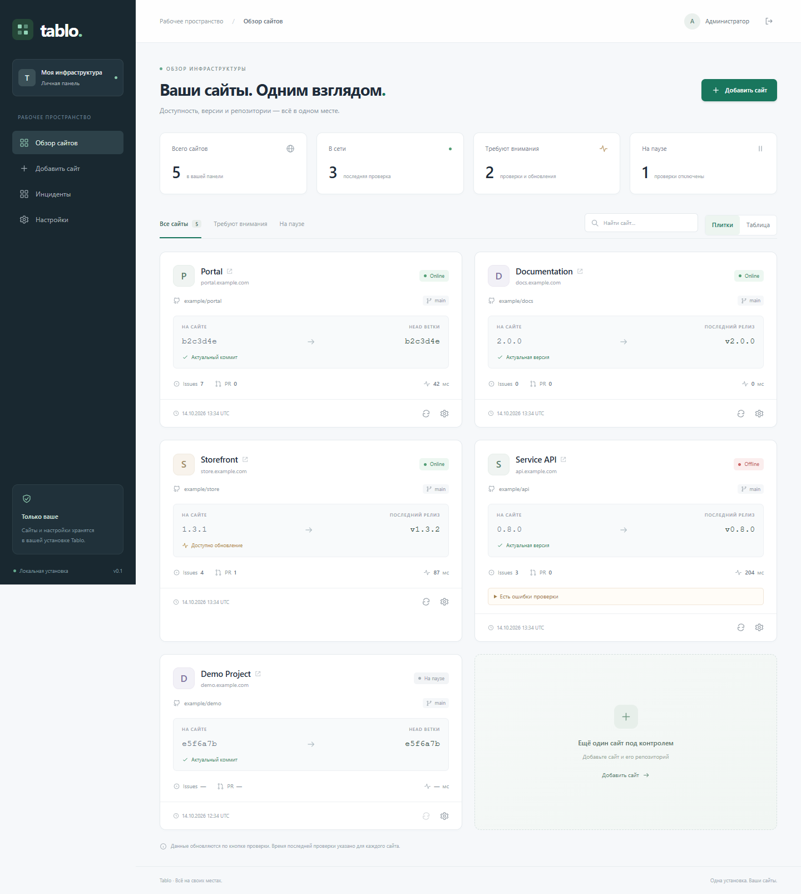
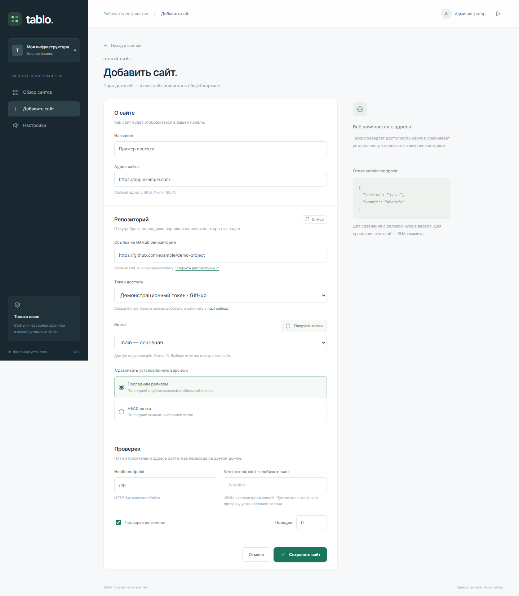
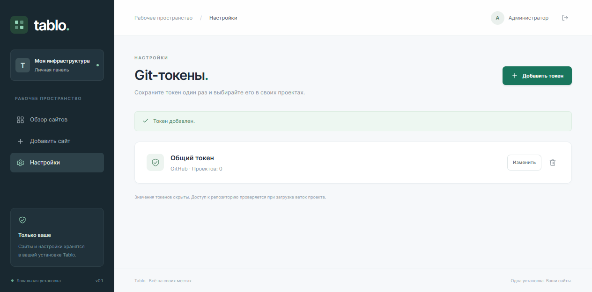
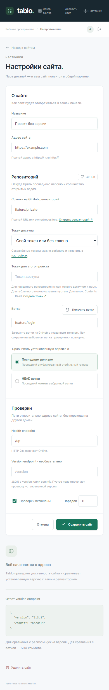

# Tablo

[Русский](README.md) | [English](README.en.md)

`README.md` is the canonical Russian documentation. Keep installation steps,
settings, commands, and links synchronized in both READMEs when behavior changes.

A small self-hosted website dashboard: availability, deployed version, latest
release or branch HEAD, issues, pull requests, and response time. One installation,
one administrator.

Phalcon **6.0.0 RC2** and Volt are installed by Composer as PHP libraries;
the native `ext-phalcon` extension is not required. PHP 8.2+, libcurl 7.55.0+,
and SQLite. No SPA, Redis, queues, or external database server. Dependencies are
pinned in `composer.lock`; the separate Volt package uses a development branch
pinned to a specific commit. The locked Phalcon release is a release candidate.

## Screenshots

These illustrations use a separate test database with fictional sites and check
results: `example/*` repositories, `*.example.com` domains, and a demonstration
Git token. They contain no real repositories, passwords, or tokens. The screenshots
show the existing Russian interface; the English README does not change the UI language.



<details>
<summary>Adding a site, selecting a token, and configuring JSON checks</summary>



</details>

<details>
<summary>Git token settings</summary>



</details>

<details>
<summary>Mobile interface</summary>



</details>

## Local installation and first login

Use Composer 2 and PHP `^8.2` with cURL, OpenSSL, PDO/pdo_sqlite, ctype,
fileinfo, iconv, JSON, mbstring, PCRE, session, and XML. Development dependencies
also need tokenizer and xmlwriter. The CI matrix covers Windows/Linux and PHP
8.2, 8.4, and 8.5. Install the locked dependencies and check the actual runtime,
as Composer's `config.platform` only controls dependency resolution.

Run from the project root, in PowerShell on Windows or a shell on Linux:

```powershell
composer install
composer check-platform-reqs
composer serve
```

Open <http://127.0.0.1:8087>. If the database is missing or has no administrator,
the application redirects to `/setup` to create a password (12–1024 **bytes**).
After setup, GET and POST `/setup` return 404, including unauthenticated requests.
There is no default password, public registration, or preinstalled site. Sign in
at `/login`; use [the local password reset](#local-administrator-password-reset)
if access is lost.

New passwords and local resets use Argon2id with 64 MiB of memory
(`memory_cost=65536` KiB), three passes (`time_cost=3`), one thread
(`threads=1`), and an automatically generated salt. Run
`php tests/fixtures/argon2id-capability.php` in the application's actual runtime
to check effective hashing and verification; an extension name or Composer
platform setting does not establish support. See the
[PHP requirements](https://www.php.net/manual/en/password.requirements.php).
When Argon2id is unavailable, an existing bcrypt credential can be verified
without rewriting its hash; setup and reset refuse safely. Restore support in
the same runtime before retrying. A failed password verification alone does
not establish provider absence.

A successful login upgrades legacy bcrypt or deficient Argon parameters to
Argon2id while retaining stronger memory/pass components. Same-policy or
stronger Argon2id hashes remain byte-identical; a thread-count difference alone
does not trigger rewriting. Legacy verification preserves exact raw bytes,
including short or empty credentials, but refuses bcrypt candidates over
72 bytes before native verification to prevent truncated-prefix aliases.
A successful upgrade or local reset invalidates prior browser sessions and
read API bearers. The complete stored API-token row stays unchanged; issue a
new token through explicit rotation after a fresh login.

Add a site with its HTTP(S) address, GitHub repository (`owner/repo` or a full
URL), token, branch, health path, optional version path, and comparison mode.
“Получить ветки” (Fetch branches) verifies repository access and loads branches
through the GitHub API with the selected token. Pick a branch from the list or
enter one manually. The server checks that it exists again when saving; a tag
cannot replace a branch.

Use ↻ on a card to check the site. Configuration changes clear the previous result;
disabled sites are not checked. Search and filters operate locally on the rendered
cards. `Online` means HTTP 200 for the homepage, or HTTP 2xx for an explicit health
endpoint with a successful JSON condition when enabled. `Offline` means another
received status for that mode or a failed JSON condition. “Нет данных” (No data)
means DNS, transport, request-policy, or JSON parsing failure; “На паузе” (Paused)
means the site is disabled. Independent version/GitHub failures do not invalidate
successful health. Missing data is not zero. Checks older than 15 minutes are marked stale.

## Site endpoints

An empty **Health endpoint**, including whitespace, checks the saved website URL
without appending `/up`. Outer whitespace is removed when saving, but the exact
address, trailing `/`, and repeated path separators are preserved:
`https://example.com/app` and `https://example.com/app/` can be different resources.
This homepage request follows no redirects. Only HTTP **200** means `Online`;
201/204/301/302/404/500 and every other HTTP status mean `Offline`.
HTML is not parsed as JSON and saved JSON check settings are ignored. Those
settings apply again when an explicit endpoint is restored.

An explicit endpoint in **HTTP status** mode must return HTTP 2xx; its body is not
checked. This is the default mode, including for existing sites. Explicit Health
and Version endpoints allow up to three redirects within the same origin, with
the security checks and shared chain budget described below.

Version is optional and empty by default. An empty Version endpoint makes no
version request: health and Git metrics still run, and missing deployed version
is not an error. When configured, the endpoint must return a JSON object with
`version` and/or `commit`:

```json
{"version":"1.3.1","commit":"a61de82"}
```

`deployed_version`, `deployed_commit`, and `sha` are also supported. A SHA contains
7–64 hexadecimal characters. Release mode compares `version`, normalizing the
leading `v`; branch HEAD mode compares a prefix of the full SHA. Different commits
do not prove that a site is behind, so the dashboard reports that they differ.

Explicit Health/version paths are joined to the site URL with one `/` at the
boundary: `https://example.com/app/` + `/version` becomes
`https://example.com/app/version`. Trailing slashes are removed only for this join;
the stored URL and endpoint query encoding are not rewritten. A trailing slash
removed by an older version can be restored by editing the site; URLs are not
automatically migrated. Manual, CLI, and worker checks use the same rule.

### Endpoint bearer token

In **Checks**, optionally set one token for this site's Health and Version
requests. It is sent only as `Authorization: Bearer …`; Git requests, branch
previews, and other sites do not receive it. Without a token, no Authorization
header is sent. Empty Version disables the version request; empty Health checks
the exact saved URL and requires HTTP 200 without following redirects.

The token input is always empty when the form opens or is redisplayed. An empty
or missing input keeps the current token; a new value replaces it. Use the
separate checkbox to remove it. Replacement and removal together are rejected.
The removal checkbox accepts `1`, `"1"`, or `"on"`. Tokens must contain 1–512
printable ASCII bytes `0x21..0x7e`; spaces, controls, DEL, and non-ASCII are rejected.
Values are neither trimmed nor transformed; `null` and other types are rejected.

SQLite stores AES-256-GCM v1 ciphertext using the existing vault key. The current
schema has nullable `endpoint_token`; upgrading an admitted older layout adds
the field without network requests or key creation. A disabled site's token also
establishes existing key state. A missing, corrupt, or known replaced key causes
safe refusal without generating a replacement. A fresh process cannot prove the
previous identity of an unknown valid legacy key without a trusted reference.

Health 401/403 yields Offline with the actual HTTP status and a neutral hint.
Version failure preserves valid Health and Git results. Corrupt site ciphertext
affects that site's endpoint checks; shared key or PDO failure remains global.
Configuration changes clear the result and advance its revision: an old response
cannot be saved even after a token changes A → B → A.

The entire Version result is rejected if the selected version string contains the
configured token, or the commit contains it after SHA lowercasing. Only a neutral
error, without those fields, reaches the result, SQLite, or dashboard. This applies
to short tokens too: token `1` matches version `1.2.3`. Choose a token that does
not occur in metadata. Arbitrary encodings or secret transformations are not detected.

The form shows token presence only. SensitiveParameter hides arguments at protected
boundaries; cURL and callback exceptions are recreated without the original exception.
This does not guarantee hiding arbitrary native state or third-party overrides.
Keep tokens out of URL/query strings and check endpoint and log security.

### Version JSON path

For a nested version, set **JSON path версии** (Version JSON path), for example
`$.build.version` for:

```json
{"build":{"version":"1.3.1"},"commit":"a61de82"}
```

The selected version must be a nonempty string of at most 200 bytes. Root-level
`commit`, `sha`, and `deployed_commit` are still detected automatically. An empty
JSON path keeps automatic `version` / `deployed_version` detection. If Version
is empty, no request is made and its JSON path is ignored.

### JSON health checks

With a nonempty Health endpoint, choose **JSON-поле** (JSON field), then set the
path, operator, and expected value. For `{"result":"ok","checks":{"passed":3}}`:

| JSON path | Operator | Expected value | Check |
| --- | --- | --- | --- |
| `$.result` | `==` | `ok` | Exact match; default operator. |
| `$.result` | `!=` | `error` | Exact mismatch. |
| `$.result` | `contains` | `o` | Case-sensitive substring. |
| `$.checks.passed` | `>` | `2` | Greater than. |
| `$.checks.passed` | `>=` | `3` | Greater than or equal. |
| `$.checks.passed` | `<` | `4` | Less than. |
| `$.checks.passed` | `<=` | `3` | Less than or equal. |

`==`, `!=`, and `contains` compare string representations: a JSON string without
quotes, a number in JSON notation, or boolean `true` / `false`. Expected whitespace
is preserved and an empty string is valid. `0`, `false`, and `""` are found values.
For `>`, `>=`, `<`, and `<=`, both operands must be finite numbers or numeric
strings; fractions, signs, and exponential notation are accepted.

HTTP 2xx plus a true condition means `Online`. A false condition means `Offline`;
non-2xx also means `Offline`, regardless of the body. Invalid JSON, a missing field,
`null`, object, array, or a nonnumeric operand in a numeric comparison yields No data
with a reason. These errors preserve independent version and GitHub results.
The full response body is not included in errors.

### Check statuses and error reasons

The same policy covers homepages, HTTP endpoints, and JSON endpoints. A received
unsuccessful HTTP status or false JSON condition means `Offline`. An incomplete
check means `Unknown` (No data in the UI): timeout, DNS, or refusal can depend on
the checking network; SSRF, TLS, and response limits do not prove the site is down.
These results need attention and produce a nonzero CLI exit code.

| Condition | Status | `health_error_code` | Dashboard reason |
| --- | --- | --- | --- |
| Homepage: HTTP 200 | Online | `null` | — |
| Homepage: any other HTTP status | Offline | `http` | HTTP code |
| Explicit endpoint: HTTP 2xx, JSON condition true or HTTP mode | Online | `null` | — |
| Explicit endpoint: non-2xx | Offline | `http` | HTTP code |
| False JSON condition | Offline | `json-condition` | JSON value failed the condition |
| Timeout | Unknown | `timeout` | Check timed out |
| Connection refused | Unknown | `refused` | Server refused the connection |
| DNS failure | Unknown | `dns` | DNS name could not be resolved |
| SSRF policy refusal | Unknown | `ssrf` | Address check prohibited |
| TLS failure | Unknown | `tls` | TLS connection could not be established |
| Response-read byte limit exceeded | Unknown | `size` | Check response size limit exceeded |
| Invalid/truncated HTTP, invalid JSON or field | Unknown | `invalid-response` | Invalid or incomplete response |
| Invalid URL | Unknown | `invalid-url` | Invalid check address |
| Safe endpoint chain did not complete | Unknown | `redirect-location-missing`, `redirect-location-invalid`, `redirect-origin`, `redirect-cycle`, `redirect-limit` | Fixed redirect refusal reason |
| Other send/receive failure | Unknown | `network` | Request or response transfer failed |
| Unrecognized check failure | Unknown | `check-error` | Check could not be completed |

`health_http_status` retains a valid received HTTP code, including on JSON errors;
it is `null` if no valid HTTP response was received. Both fields are stored in
SQLite, cleared on configuration changes, and updated identically by manual and
CLI checks. Reasons appear in the card error and status tooltip. Older records
get `null` until the next check; their previous errors remain. Reasons contain no
URLs, headers, response bodies, or cURL text.

Malformed chunked framing is `invalid-response` only when cURL's native decoder
explicitly recognizes the format error. cURL code 56 or chunked encoding alone
does not prove that: ordinary receive/reset remains `network`. Incomplete responses
keep Unknown and null HTTP status/response time. Version or GitHub failure does
not change the health outcome or reason.

### JSON path syntax and limits

Health and version paths use the same restricted selector:

| Path | Selects |
| --- | --- |
| `$` | Root value. |
| `$.build.version` | Nested object field. |
| `$.services[0].status` | Field of the first array element. |
| `$["build.version"]` | Key containing a dot. |
| `$["версия"]` | Key containing Unicode characters. |

After a dot, a name starts with an ASCII letter or `_` and contains ASCII letters,
digits, or `_`. Other keys use double quotes with JSON escaping. Array indices
are nonnegative integers without leading zeros. Paths are limited to 512 bytes,
expected values to 512 characters, and JSON depth to 16. Expressions, functions,
wildcards, filters, and recursive search are unsupported. Both modes share the
response-size, timeout, and SSRF limits.

Active paths and conditions are validated on the server when saving; errors appear
next to the relevant field. Changing any JSON setting clears the previous result
and prevents an in-flight check with old settings from being stored. Manual checks
and `php bin/check.php` use the same logic. Existing SQLite layouts are upgraded
automatically; existing sites retain HTTP mode and automatic version detection.

### Git tokens and branches

`RepositoryProvider` is a small four-method contract. Only `GitHubProvider` is
implemented; GitLab/Gitea/Forgejo adapters are not available. Issues and PRs use
separate GitHub search requests; incomplete responses and API limits appear as
errors. Latest release excludes drafts and prereleases.

Add a named token at **Настройки → Git-токены** (Settings → Git tokens, `/settings`).
When adding or editing a site, select it from the list or enter a token for that
site alone. A saved token can serve several sites. Replacing it clears their check
results; move sites to another token before deleting one they use. Leaving the
token input empty while editing preserves its previous value. `GITHUB_TOKEN` is
not an application environment credential; use these controls.

`git_tokens` stores the provider, name, and encrypted value; a site refers to a
saved token through `git_token_id`. The `GitProviders` registry and
`RepositoryProvider` contract permit future adapters; only GitHub is currently
available. Existing inline site tokens continue to work.

For branch listing, a fine-grained token needs repository access and **Contents:
Read** ([GitHub branch documentation](https://docs.github.com/en/rest/branches/branches)).
For private issues and PRs, also grant **Issues: Read** and **Pull requests: Read**.
Public repositories do not require a token. The administrator password and GitHub
token are separate credentials.

Saved and inline tokens are AES-256-GCM encrypted in SQLite. In legacy mode,
`github-token.key` is created beside the database on first token save or the first
authenticated preview in an empty installation. When encrypted credentials or
private quota identities exist, preview with a missing key requires restoring
the original backup before creating any file or making GitHub requests. Token
inputs stay empty: empty keeps, a new value replaces, and the checkbox removes.
Tokens are not returned in HTML/JSON and are sent only in Authorization to
`api.github.com`. Branch preview saves neither token nor site. Branches load in
pages of 100; exceeding ten pages or the request time limit gives an error and
leaves manual branch entry available.

## Configuration and one-shot CLI

Web and CLI load the optional project-root `.env` through Composer autoload.
Existing process variables take precedence. If `.env` is absent, environment
variables and defaults apply. Restart long-lived PHP processes/workers after
changing `.env`.

```dotenv
TABLO_DB="D:/data/tablo.sqlite"
TABLO_ALLOW_PRIVATE_NETWORK=0
TABLO_COOKIE_SECURE=0
```

On Windows, use forward slashes or single quotes around paths with backslashes.
Relative database paths are resolved from the PHP process's working directory;
use an absolute path when launching elsewhere. Compose reads `.env` for interpolation
and passes only the variables explicitly mapped by `environment` in `compose.yaml`.
The local `.env` is excluded from the image.

| Variable | Meaning |
| --- | --- |
| `TABLO_DB` | SQLite path; default `storage/tablo.sqlite`. |
| `TABLO_TOKEN_KEY_FILE` | Empty by default: legacy key beside the database. A nonempty value selects an existing read-only file containing the original 32 raw key bytes; relative to the project root. |
| `TABLO_ALLOW_PRIVATE_NETWORK` | Exactly `1` opts into localhost/private-network monitoring; default `0`. |
| `TABLO_COOKIE_SECURE` | Set `1` behind an HTTPS reverse proxy. Direct HTTPS is detected automatically. |
| `TABLO_TRUSTED_PROXIES` | Empty by default. Comma-separated exact trusted proxy IPs for application mode; rules below. |
| `TABLO_HISTORY_RETENTION_DAYS` | Default 30 days when absent; canonical integer 1–3650 without leading zeros. Used only by explicit history pruning; empty is invalid. |

Base Compose explicitly sets its container database path and does not automatically
forward a host `TABLO_DB` override or `TABLO_HISTORY_RETENTION_DAYS`. For an external
vault key, use [the opt-in overlay](#external-read-only-token-vault-key).

Explicit nonempty Health and enabled Version endpoints allow up to three manual
redirects (four GET requests) for 301/302/303/307/308. GET remains GET; other 3xx
are final HTTP responses. Empty Health requires homepage 200 with no redirects;
empty Version sends no request. GitHub requests do not follow redirects.

Every redirect must remain within the original origin: the same canonical HTTP(S)
scheme, hostname/IP, and effective port. Hostname case and an explicit default port
do not change origin. CNAMEs, another hostname, an IP replacing a name, another
port, or a changed scheme do. Cross-origin redirects, including HTTPS downgrades,
are rejected before the target request and the complete bearer header set is detached.
No cookies or Referer are created.

Relative Location follows RFC 3986. Userinfo, fragments, controls, ambiguous numeric
addresses, IPv6 zones, and invalid/empty/duplicate Location are rejected. Overlapping
reasons are checked in this order: syntax, origin, cycle, redirect limit. Only the
final header block's Location controls a redirect; interim headers and trailers do
not. Some libcurl versions, including native 8.17.0, reject differing Location
values in interim 103 and final 302 before the callback. That incomplete response
safely yields Unknown/`redirect-location-invalid` without contacting the target;
successful handling of that combination is not promised on those versions.
Accepted same-origin Location query bytes are preserved and can reach that origin;
they are not assumed secret-free and are omitted from diagnostics.

By default, every explicit endpoint hop, including the first, rechecks all A/AAAA
answers and pins one validated address on a fresh cURL handle. The conservative
static policy excludes special blocks from the official
[IANA IPv4](https://www.iana.org/assignments/iana-ipv4-special-registry/) and
[IANA IPv6](https://www.iana.org/assignments/iana-ipv6-special-registry/) registries
(reviewed 2026-10-11), including multicast, shared/benchmark/documentation, mapped,
and translation ranges. IPv6 is allowed only from global-unicast 2000::/3 with
special-block exclusions, including otherwise globally reachable exceptions inside
those blocks. With `TABLO_ALLOW_PRIVATE_NETWORK=1`, every fresh handle uses system
name resolution, including hosts/localhost, without public DNS preflight/pinning.
URI, origin, limit, and TLS checks still apply. Environment proxies and automatic
cURL redirects are disabled.

An endpoint chain has one monotonic six-second budget bounded by its outer deadline;
connect timeout is at most three seconds and no more than the remaining budget.
Synchronous DNS can exceed it: before/after checks prevent the next HTTP request
but do not impose a hard DNS timeout. The total response-read limit is 1 MiB of
received header bytes plus decoded body bytes, with an additional 64 KiB header
limit including interim blocks and trailers. This is not a raw wire/TLS ceiling:
chunk framing and TLS overhead are excluded. Generic homepage/Git transport keeps
its separate 1 MiB decoded-body limit.

Failed Health chains produce Unknown with a fixed reason and no intermediate 3xx
status. Completed final 401/403/404/500 produce Offline/http. Version failures preserve
valid Health/Git, and vice versa. GitHub tokens go only to `api.github.com`; TLS
certificates are verified.

Run one finite check of every enabled site:

```powershell
php bin/check.php
```

For a local machine consumer, request JSON explicitly:

```powershell
php bin/check.php --json > check-result.json
php bin/check.php --json --help
```

stdout contains one `tablo/check/v1` document following the published
[schema](contracts/check-output-v1.schema.json); safe diagnostics go to stderr.
`run.status` is `success` (exit 0), `partial`, or `fatal` (exit 1). An empty list
gives `success/empty`; loading/database failure gives `fatal`. `--json --help`
gives `success/help` before configuration, database, or key loading. JSON mode
accepts exactly one `--json` and optionally one `--help`, in either order; unknown
arguments or selectors give `fatal/invalid-arguments`. Plain text invocation keeps
its existing output and ignores arguments.

Each row includes ID, separate health/version/Git outcomes, and fixed reason codes.
`online`, `offline`, and `unknown` differ; disabled sites are `paused/disabled`,
with no requests or writes. Missing numbers stay `null`; real zero stays `0`.
Confirmed absence of a release is `absent/no-release`. v1 publishes no version
labels, SHAs, names, URLs, tokens, or raw errors.

`observation` is the measured outcome; `persistence.accepted` is the actual
`storeCheck()` result. `rejected-stale` preserves the observation without guessing
the race cause. `previous_checked_at` and `previous_freshness` describe the snapshot
**before checking**, rather than a database modified by another writer. An accepted
timestamp matches the observation timestamp. Freshness becomes `stale` after 900
seconds; invalid previous timestamps become `null/unknown`. After a late fatal
error, completed rows remain and remaining rows become `skipped/run-aborted`.
A failed write has `persistence.status=unknown`; an unstarted write is `not-attempted`.
JSON mode changes neither checks, provider limits, nor scheduler state.

Handled configuration, serialization, and check errors produce complete JSON. OS
termination, OOM, or broken stdout can prevent delivery: consumers must validate
both JSON and exit status and must not automatically repeat writes.

Use cron or Task Scheduler with the same environment for scheduled one-shot checks.
Checks are serial; choose intervals for the site count and GitHub search quota.
Exit `1` means failure, Offline, or a configuration change during the check.
Accepted results already append [history](#check-history); retention pruning is
explicit. See [Periodic worker](#periodic-worker) for the long-running process and
[Read API](#read-api) for external reads.

## SQLite migrations

`PRAGMA user_version` holds the schema version. An empty database or an admitted
older installation is upgraded automatically to **10**. Admission checks the
actual layout: historical versions include different endpoint-token and history
compositions, rather than a single linear v4/v5 chain. The current schema includes
health diagnostics, GitHub cooldowns, worker settings/state, endpoint tokens,
history, incidents, notifications, idle timeout, and the read API token.
Only missing supported changes are applied; existing sites, endpoints, credentials,
and results are preserved.

Table creation, missing columns, and the version update share one transaction.
On failure it rolls back and a later connection can retry. Upgrades do not replace
the administrator password, sites, encryption key, or saved tokens. For a current
schema, the migrator validates the supported physical layout and foreign keys
without applying DDL or acquiring the migration write lock. Concurrent processes
recheck after acquiring the lock and skip an already completed upgrade.
A future version or incompatible old layout is refused without modifying data;
never lower `user_version` to run an older application. The separate Read API
reader requires a current installation and never migrates it.

`database/schema.sql` is the fixed version-1 bootstrap. Future changes belong in
separate migrator transitions with a version increase. Migration itself does not
change journal mode. Unit/Network migration tests include concurrent PHP processes
and SQL failure cases.

## SQLite WAL storage and maintenance

After a successful migration, `Database::connect()` enables and checks
`journal_mode=wal` for file databases. `foreign_keys=ON` and `busy_timeout=5000`
are set before migration/journal negotiation; `:memory:` retains `memory` mode.
Unsupported modes are refused without falling back to DELETE. WAL survives reopen.
This policy does not change schema version, DDL, or rejected future-schema metadata.

Use ordinary writable local storage on **one host**. Web and CLI/worker must use
the same `TABLO_DB` and compatible Unix users/groups or Windows ACLs for its
directory, database, `-wal`, `-shm`, and adjacent `github-token.key` when used.
Mount the whole `storage/` directory rather than one database file. NFS, SMB/UNC,
network volumes, cloud-drive synchronization, and multi-host shared storage are
unsupported. PHP cannot reliably identify the volume type; the operator must check
it. A named Docker volume needs a local driver; its name alone proves no locality.

**Operational runtime requirement:** every process opening the database must use
SQLite with the [WAL-reset fix](https://www.sqlite.org/wal.html#walresetbug).
SQLite **3.51.3 or newer**, official backports **3.44.6 / 3.50.7**, or a vendor
package with a documented backport qualify. Check
`SELECT sqlite_version(), sqlite_source_id()` through PDO in both web and CLI
runtimes: neither PHP's version nor the external `sqlite3` command proves which
library PDO loads. For older version numbers, retain the vendor patch/changelog
reference and exact package version.

The Dockerfile builds SQLite **3.53.4** from an official upstream archive, pins
its SHA256, verifies `sqlite3.c` SHA3-256 against the
[release page](https://sqlite.org/releaselog/3_53_4.html), and links PDO to
`/opt/tablo-sqlite/lib`. Build-time PDO checks require the exact SQLite version and
source ID. Rebuild to install this library. `php /usr/local/bin/tablo-sqlite-runtime.php`
repeats the check in container CLI; verify those SQL functions through Apache/PDO
for a changed web runtime. Host installations need an updated runtime or documented
vendor backport; `php:8.4-apache` and a PHP version alone do not prove the fix.
The application checks WAL mode but neither detects backports nor blocks old
runtimes. Ordinary concurrency/recovery tests cannot prove an unfixed SQLite safe:
the upstream defect depends on a rare writer/checkpoint race.

WAL lets a writer commit while a reader holds a snapshot, but there is still only
one writer. A second writer can receive `SQLITE_BUSY` after bounded waiting.
Normal `busy_timeout=5000` controls SQLite lock waiting. After migration, WAL
negotiation uses its own shared monotonic 5000 ms budget: native busy timeout is
zero during this phase, the cursor is freed before each retry, and 5000 ms is
restored on success or failure. An already-WAL database needs no switch. Only
SQLite BUSY, BUSY_RECOVERY, and BUSY_TIMEOUT permit retries; unsupported mode is
refused immediately. This bounds managed WAL waiting, not scheduler, filesystem,
or driver delays. Migration has separate lock waiting, so opening the database
or serving the HTTP request can take longer.

Do not hold read transactions during network requests: long snapshots delay
checkpoints and grow WAL. SQLite's automatic checkpoint remains enabled by default.
`-wal` can contain committed data absent from the main file. Never manually delete
sidecars or treat sequential live database/WAL copies as a consistent backup.
After a crash, preserve database and sidecars together and let SQLite recover on
open. For integrity errors, restore a verified backup rather than deleting WAL or
creating a new key. Process-kill recovery tests do not establish power-loss or
disk reliability.

### Checkpoint

Stop web and every CLI/worker and wait for PDO/PDOStatement closure. Open the
existing database through a separate PDO, set `busy_timeout=5000`, then run:

```php
$result = $db->query('PRAGMA wal_checkpoint(TRUNCATE)')->fetch(PDO::FETCH_NUM);
if ($result !== [0, 0, 0]) {
    throw new RuntimeException('Checkpoint incomplete; check active connections.');
}
unset($db);
```

The result is `(busy, frames_in_wal, checkpointed_frames)`. With an active reader,
TRUNCATE can return busy and leave frames; end the long transaction and retry
during maintenance. `(0,0,0)` means TRUNCATE completed. A zero-length WAL need not
disappear while connections remain open. The last normal SQLite close usually
removes `-wal`/`-shm`; crashes can leave them behind.

### Consistent backups

PDO supports `VACUUM INTO` without requiring the sqlite3 command or `ext-sqlite3`.
It snapshots committed WAL changes as of snapshot start, without promising later
commits. Use a separate connection with no transaction or unfinished statements,
a new destination file, and SQL quoting for its path. Prefer a maintenance window
with web and CLI/worker stopped for a matching database/key pair. For an online
backup, ensure the existing key cannot change during copying.

First identify the actual database and key using the same configuration as web
and worker: process environment precedes root `.env`; relative `TABLO_DB` uses
CWD, while relative `TABLO_TOKEN_KEY_FILE` uses the project root. A standalone
`php` script without Composer autoload does not load `.env` itself. Legacy mode
uses adjacent `github-token.key`; external mode needs the file selected by
`TABLO_TOKEN_KEY_FILE`, rather than any leftover adjacent copy.

During maintenance, stop all consumers, verify the selected existing files, and
open a separate PDO for the snapshot. Given an operator-prepared `$db` and a new
absolute `$snapshot` path, the core operation is:

```php
$db->exec('VACUUM INTO ' . $db->quote($snapshot));
```

This is an operation fragment, not a standalone installation-selection script.
Open the snapshot separately and require `PRAGMA integrity_check` to return exactly
`ok` and `PRAGMA foreign_key_check` to return no rows; then close both connections.
Back up the selected key's original bytes with the snapshot and confirm the pair
before resuming consumers. The key protects Git, endpoint, and notification
credentials, as well as private quota identities even after encrypted tokens are
removed. If stored state requires a missing original key, the backup is incomplete;
do not generate a replacement. The read API token is digest-only and does not
replace the vault key.

Interrupted `VACUUM INTO` leaves an incomplete output file, which is not a backup.
Move the verified pair outside the live directory/volume and restrict access
(Windows ACLs; Unix directory 0700 and files 0600). A backup in the same volume
does not protect against losing it. For a raw file copy, first stop **all**
consumers, close connections, complete and verify the checkpoint, and close the
maintenance PDO; only then copy database and key. Pausing writes alone is insufficient.

### Restore

1. Stop web and all CLI/workers. Preserve the previous database, key, and crash
   sidecars together elsewhere for diagnosis and rollback.
2. Check snapshot integrity and foreign keys, then restore to a clean database
   destination and the chosen legacy/external key location with working permissions.
   In external mode configure the matching `TABLO_TOKEN_KEY_FILE`. Do not combine
   a snapshot with old `-wal`/`-shm` or create a new key to replace a lost one.
3. Open through `Database::connect()` and verify WAL, `user_version`, integrity/FKs,
   administrator, sites, and token decryption without printing secrets. For an
   incompatible future schema, use a compatible application rather than lowering metadata.
4. Resume web and CLI/worker only after verification. Sessions need not be transferred.

Committed `DatabaseWalTest` regressions cover independent processes, DELETE-mode
controls, timeout/retry, stale raw copies, paired-key backup, checkpoint,
crash/recovery, and file release, including held PDOStatements on Windows.

## Docker installation and container liveness

```powershell
docker compose up --build -d
```

Open <http://127.0.0.1:8087>. The container uses Apache/PHP and stores data in
the named `tablo-data` volume. Stop a local PHP server first if it uses that port.
For publication use an HTTPS reverse proxy and `TABLO_COOKIE_SECURE=1`.
DocumentRoot must always point to `public/`.

The image checks local HTTP/PHP serving liveness through exact `GET /_tablo/health`
with Host `127.0.0.1` (optional `:80`) and original loopback `REMOTE_ADDR`.
Success is `200`, `text/plain; charset=utf-8`, `no-store`, `nosniff`, body `ok\n`,
and no cookie. The probe loads production Composer autoload, including `.env`,
and application/Phalcon definitions and checks required PHP extensions. It creates
no Web, database, vault, session, or Volt runtime and performs no site/GitHub checks.
It works before and after setup. A corrupt database, missing key, or unavailable
storage can coexist with `healthy`: this does not check DB or worker readiness.

The client contacts only `http://127.0.0.1:80/_tablo/health`, ignores environment
proxies, follows no redirects, and sends no credentials/cookie. Connect timeout is
500 ms; total transfer timeout 2000 ms; body limit 16 bytes; header limit 4096 bytes.
Docker runs it every 30 s with timeout 5 s, start period 20 s, and three retries.
Direct exit 0 means success, exit 1 means failure; diagnostics are fixed `healthy`
or `unavailable`. After consecutive failures, a **running** container becomes
`unhealthy` and returns to `healthy` when HTTP/PHP recovers. A stopped container is
`exited` and runs no probes. Restart policy does not restart it solely for being
`unhealthy`. The worker disables the inherited HTTP probe because it serves no Apache.

```powershell
docker compose ps
docker inspect --format '{{json .State.Health}}' $(docker compose ps -q tablo)
docker compose exec -T --user www-data tablo php /usr/local/bin/tablo-healthcheck.php
```

The reverse proxy must block `/_tablo/health` and variants from external clients.
A loopback proxy can make an external request appear local to Apache;
`REMOTE_ADDR` does not authenticate the original client. Forwarded headers and
`TABLO_TRUSTED_PROXIES` do not control probe admission. Wrong Host/peer or query/
trailing path returns 404; a wrong method on the exact local URI returns 405 with
`Allow: GET`. Production load failure returns fixed 503 `unavailable\n` without
configuration details.

Unexpected headers/cookies or load-time output cause refusal. PHP headers are
restored and nested buffers removed without disturbing the outer buffer (up to
32 removals; if blocked, the retained filter emits refusal on completion). This
contains ordinary loading failures rather than arbitrary PHP: forced HTTP header
flushes, destroying the filter then emitting output, `exit`, or malicious shutdown/
output callbacks cannot guarantee a fixed HTTP response. The client still requires
the exact successful status and body within its limits.

### Client address and trusted proxies

Login limiting stores five failed attempts per address for 900 seconds in SQLite.
Choose **one** of two mutually exclusive address-restoration modes. Switching
modes does not change the schema. `TABLO_TRUSTED_PROXIES` does not affect HTTPS,
cookies, session duration, or outgoing site checks.

**Application mode:** PHP receives the connection's original `REMOTE_ADDR`. Set
`TABLO_TRUSTED_PROXIES=192.0.2.10,2001:db8::10`, replacing examples with verified
proxy IPs. Only exact IPv4/IPv6 addresses are allowed, with spaces/tabs around
elements. CIDR, wildcards, names, URLs, ports, brackets, zone IDs, unspecified
`0.0.0.0`/`::`, and empty elements are rejected. Limits are 4096 bytes and 32
elements before equivalent configuration duplicates are removed. Partial acceptance
is forbidden: `Invalid TABLO_TRUSTED_PROXIES configuration.` stops Web before
runtime/session/database creation, without echoing values. PHP 8.2 SensitiveParameter
replaces the configuration argument with SensitiveParameterValue in captured traces.
Unset or exactly empty disables trust; whitespace-only is an error. Private,
loopback, and Docker networks are not automatically trusted.

On the exercised native Windows PHP 8.5 build, empty environment entries can be
lost when starting child PHP, letting Dotenv reload a saved `.env` value. `getenv()`
can still return empty inside the parent process; this is not universal unset
semantics. To disable trust on Windows, also clear/change `.env` and restart PHP.
On exercised Linux PHP 8.2/8.4, an empty entry actually passed with
`env TABLO_TRUSTED_PROXIES= php ...` survives and prevents Dotenv from restoring
saved trust. Empty entries in PHP `proc_open` environment arrays are also lost on
those Linux builds. Verify the child's actual environment, not only launcher settings.

Empty configuration or an untrusted direct peer ignores X-Forwarded-For entirely
and uses canonical `REMOTE_ADDR`. Invalid transport addresses share a fixed
`unknown` bucket. `Forwarded`, `X-Real-IP`, `Client-IP`, `X-Forwarded-Proto`, and
other aliases never select the client address. A trusted direct peer must send
a valid X-Forwarded-For: at most 4096 bytes and 32 comma-separated IPs with SP/HTAB
around them. Empty elements, controls, `unknown`, names, CIDR, quotes, brackets,
ports, and zones are rejected.

The entire chain is validated, then traversed right to left while the current
node is trusted. The first untrusted node is selected. With trusted `.20` and
`.10`, peer `192.0.2.20`, and header
`203.0.113.99,198.51.100.42,192.0.2.10`, the selected client is `198.51.100.42`.
If `.10` is untrusted, it is `192.0.2.10`; entries further left have no authority.
Repeated IPs remain separate hops; the chain is neither sorted nor deduplicated.
IPv6 case/compression normalize; IPv4-mapped IPv6 collapses to IPv4 for trust and
rate-limit identity, so `::ffff:c633:642a` and `198.51.100.42` share a bucket.
A missing, invalid, oversized, or entirely trusted chain yields 422
`Invalid trusted proxy address chain.` before Auth: no peer fallback bucket,
password check, counter reset, or authorization.

A public nginx edge must **overwrite** incoming XFF with the observed address:

```nginx
location / {
    proxy_set_header Host $host;
    proxy_set_header X-Forwarded-For $remote_addr;
    proxy_pass http://tablo_backend;
}
```

An internal proxy may use
`proxy_set_header X-Forwarded-For $proxy_add_x_forwarded_for;` only behind a
verified edge with ingress restricted to its controlled predecessor. Appending
does not sanitize earlier entries. The public proxy must overwrite or reject
duplicate wire headers: PHP SAPI can combine several XFF fields into a string
indistinguishable from a normal chain. The application cannot promise to detect
those duplicates. See [nginx proxy module](https://nginx.org/en/docs/http/ngx_http_proxy_module.html).

**PHP server mode:** leave `TABLO_TRUSTED_PROXIES` empty. On Apache serving PHP,
explicitly load the available `mod_remoteip` and configure:

```apache
RemoteIPHeader X-Forwarded-For
RemoteIPTrustedProxy 192.0.2.10
RemoteIPTrustedProxy 2001:db8::10
```

`RemoteIPHeader` without a trust list trusts every sender. Controlled internal
proxies carrying private client addresses need `RemoteIPInternalProxy` with those
same exact sources instead. The module walks right to left and may alter/remove
XFF. Verify PHP's resulting `REMOTE_ADDR`. Tablo's Dockerfile does not automatically
enable remoteip. See [Apache mod_remoteip](https://httpd.apache.org/docs/2.4/mod/mod_remoteip.html).

nginx serving PHP through FastCGI needs the real-IP module, exact
`set_real_ip_from 192.0.2.10;` / `set_real_ip_from 2001:db8::10;`,
`real_ip_header X-Forwarded-For; real_ip_recursive on;`, and restored `$remote_addr`
passed as FastCGI `REMOTE_ADDR`. Enabling real-IP only on an HTTP reverse proxy
does not restore the address in an Apache backend: use application mode or
Apache restoration. See [nginx real-IP](https://nginx.org/en/docs/http/ngx_http_realip_module.html).

Do not combine server restoration with application parsing. Verify the observed
backend peer, modules, sanitization, and access restricted to the intended proxy,
including direct requests with forged headers. Docker/NAT may expose a gateway
rather than localhost; do not trust the entire bridge network. Shared NAT or a
neighbor's IP does not prove proxy ownership: use dedicated ingress/ACLs. Compose
publication remains `127.0.0.1:8087:80`. Local fixtures do not prove deployment topology.

When rolling address policy, canonicalization, or trust lists forward/backward,
existing irreversible address hashes can select different buckets. For strict
limit preservation, close `/login` at ingress and wait **strictly more than 900
seconds** after the last allowed attempt before changing and reopening it.
Preserve database, keys, and sessions; do not delete counters/storage. Rollback
needs no database downgrade but may group clients behind a proxy into one limit again.

Create the administrator during initial local setup before publication. Follow
the WAL backup/restore steps; the database includes the password hash. Preserve
the selected vault key, adjacent or external, whenever stored credentials need
it. Sessions need not be transferred. Supported upgrades preserve sites and the
administrator. Source, SQLite, `.env`, and dependencies must remain outside web root.

## Local administrator password reset

`bin/admin-password.php` changes the existing administrator locally. The server
may remain running: administrator row 1 exists continuously, and GET/POST `/setup`
remain 404 before, during, and after change/rollback. If SQLite cannot admit a
read, such as a PENDING lock while COMMIT waits, a request may return the existing
storage HTTP 500; setup does not open. The 404 guarantee assumes database reads work.

The command changes only the password hash. ID, created_at, schema, sites, results,
encrypted Git tokens, and key bytes stay intact. It neither reads nor creates the
key; a missing/unreadable key does not block password reset. Session files are not
deleted. Never delete the administrator, SQLite, or vault key to recover access.

First check the selected installation from the intended project root:

```powershell
php bin/admin-password.php --show-installation
```

Output identifies the canonical path of the **actually opened** database,
administrator ID, and schema version; path controls are escaped. Selection is an
explicit database API path, then process `TABLO_DB`, then root `.env` without
overwriting process environment, otherwise `storage/tablo.sqlite`. Relative paths
depend on CWD. Existing file URIs are supported. Read-only/memory URIs, including
percent-encoded parameters, and enabled/ambiguous immutable/nolock are refused:
reset requires writes and SQLite locks. Explicit false/0/off/no for immutable/
nolock is accepted; the original URI reaches PDO unchanged. Any unsafe duplicate
parameter is refused rather than relying on SQLite core/VFS duplicate selection.

Any explicit `vfs` parameter, including empty, encoded, or repeated, is refused
**before PDO opens** because custom VFS can bypass locking. URIs without `vfs`
use SQLite's normal selection. Parameter names are case-sensitive; `+`, dots,
and underscores are not normalized as HTML forms. SQLite ignores real fragments
after `#`. Existing `cache=shared/private` and `psow` handling remains: no locking
violation is established for them, but hardware/filesystem durability is not promised.

The CLI creates no database/directory and performs no migration, chmod, or journal
switch. Missing, temporary, corrupt, unusable, or incompatible databases, invalid
users tables, and missing administrators are refused. Upgrade an older schema
separately through a supported normal application start. Reset is not a migrator.
Backup/restore and replacement of a live database file need separate operator coordination.

Windows PowerShell 5.1 or PowerShell 7 uses hidden prompts and direct UTF-8 stdin.
Run the helper from the intended installation. Passwords do not pass through argv,
environment, the PowerShell pipeline, or JSON:

```powershell
powershell -NoProfile -File tools/admin-password.ps1
# PowerShell 7, when installed:
pwsh -NoProfile -File tools/admin-password.ps1
```

The helper uses SecureString, UseShellExecute=false, and StandardInput.BaseStream.
It creates BOM-free stdin, including with Windows PowerShell 5.1's BOM host encoding.
Temporary Console.InputEncoding applies only while creating the child/writer and
is restored in finally, including launch failure. No caller encoding setup is needed.
BSTR is released through ZeroFreeBSTR, temporary char/byte buffers are cleared,
and the PHP/Docker exit code is returned. This does not promise erasure of every
managed-memory copy. Ctrl+C at a prompt starts no child; after interrupting data
already sent, check normal login first because COMMIT may have completed.

On Linux use **Bash**; `read -s` is not portable `sh`:

```bash
php bin/admin-password.php --show-installation
bash tools/admin-password.bash
```

The Bash helper disables xtrace before input, reads with `IFS= read -r -s` from
`/dev/tty`, sends two lines through built-in printf, and returns the command's exit
code. EXIT/INT/TERM clear variables; canceling the prompt starts no CLI. Disable
tracing/secret recording in custom producers. Automation must supply a protected
source directly to stdin, without literals in commands, history, argv, logs, or
public files.

`--password-stdin` accepts exactly two UTF-8 lines (password and confirmation),
each terminated by LF or CRLF, followed by EOF. Only line endings are removed;
spaces remain. TTY, BOM, NUL, extra/unterminated lines, unsupported encoding/framing,
mismatch, or overflow cause refusal. Shared web/CLI validation requires 12–1024
**bytes**, exact confirmation without trimming or normalization, Argon2id with
64 MiB/three passes/one thread, and a random salt. Both fields are bounded before
comparison. The stdin payload limit is 2052 bytes with CRLF or 2050 with LF;
a 1025-byte line or overflow is refused. Six Cyrillic letters can supply 12 bytes.
Newlines allowed by general web validation cannot be represented by this separate
stdin protocol. The command cannot establish a third-party producer's security.

Compose uses the mounted installation volume, not local storage. PHP runs as
www-data (UID 33); use that user without extra published ports or volume deletion.
Select the correct Compose project/configuration before preflight:

```bash
docker compose exec -T --user www-data tablo php bin/admin-password.php --show-installation
bash tools/admin-password.bash Docker
# If the service is already stopped:
docker compose run --rm --no-deps -T --user www-data --entrypoint php tablo bin/admin-password.php --show-installation
bash tools/admin-password.bash DockerStopped
```

Windows uses the same protected input and fixed Docker arguments:

```powershell
powershell -NoProfile -File tools/admin-password.ps1 -Mode Docker
# If the service is already stopped:
powershell -NoProfile -File tools/admin-password.ps1 -Mode DockerStopped
```

The helper sends stdin to `docker compose exec -T --user www-data tablo php
bin/admin-password.php --password-stdin` or `docker compose run --rm --no-deps -T
--user www-data --entrypoint php tablo bin/admin-password.php --password-stdin`.
The stopped-service form mounts the same volume, starts no dependencies, and
publishes no service ports. A running service need not be stopped just to reset
the password. `-T` disables the default TTY for stdin. See
[Compose exec](https://docs.docker.com/reference/cli/docker/compose/exec/) and
[Compose run](https://docs.docker.com/reference/cli/docker/compose/run/).

The CLI fixes its chosen hash snapshot **before** reading stdin. The helper's
two protected prompts precede CLI startup, so selection does not precede those
prompts. Two processes sharing
one old snapshot cannot overwrite each other: one succeeds and the other reports
conflict/busy. A deliberate later change with a new snapshot is allowed. The same
current password and a repeated completed change are refused without rehashing.
There is no automatic snapshot reacquisition or retry. Validation/hashing precede
BEGIN IMMEDIATE; errors roll back an owned unfinished transaction. Failed rollback,
process death, or lost output after COMMIT cannot guarantee old state: check normal
login before another attempt.

Old passwords stop authenticating and old sessions are rejected before their next
protected GET/POST, including old CSRF. Sessions store only a domain-derived marker,
not the password hash. Legacy sessions without a marker require login after
upgrade. A login that checked the old password before COMMIT can create a cookie
later, but the next protected request rejects it. Rehash binds the caller's session
to its own new hash and revokes previous snapshots. Already admitted work may
finish; no retroactive cancellation is promised. Cookie/CSRF protections remain;
absolute session lifetime is 12 hours.

### Administrator idle timeout

Settings separates administrator inactivity from worker cadence. Default idle
timeout is **30 minutes**; integers **1–720 minutes** are allowed. Zero/disable is
unsupported. Input accepts only ASCII digits, including leading zeros; signs,
whitespace, fractions, and exponents are refused. Updating one singleton setting
preserves the others.

Successful dashboard navigation, valid CSRF forms, manual checks, and branch loads
count as activity; validation 422 on an otherwise admitted form also counts.
Failed login, unknown routes/resources, rejected CSRF, and oversized requests do
not extend the window. The server handler selects the activity category; client
headers/parameters cannot change it. Future polling must use the explicit automatic
request category, which advances only last observation, not the idle window.
The existing [Read API](#read-api) uses a separate read-only bearer, independent
of Git/endpoint tokens and administrator cookies, and does not extend browser
sessions. Dashboard polling is not implemented.

Authorization start time never moves. Exactly at the current idle boundary or
**12 hours after login**, authorization expires before the protected action.
Each admitted request uses the current saved policy: lowering it can revoke other
sessions on their next request; raising it cannot revive a revoked session.
Older sessions missing the timing fields require **one new login** after upgrade.
Times before the last admitted observation are refused. An unnoticed backwards
clock change still above the prior observation cannot be detected this way.

Network handlers release the native file-session lock before waiting. Before
persisting results they reread the original session, password, and current policy,
so concurrent logout, expiry, password change, or new login cannot restore old
rights or save an outdated notification.

Password CLI changes no login_limits rows. Blocked addresses remain blocked until
their existing 900-second window expires even with a new password. An unblocked
client can log in; normal successful login clears only its own bucket, retaining
ordinary expired-window cleanup.

Password CLI exits: 0 for COMMIT/preflight/help; 2 for invocation/input/password;
3 for unusable installation/administrator/schema; 4 for busy/stale conflict;
1 for storage/unexpected error. stdout identifies selection/status; stderr contains
only a fixed safe error. No passwords, DSN/query, configuration, tokens, keys,
hashes, or markers are printed. `--help` lists the only supported modes.

## Lekalo workflow

The project was initialized with
`lekalo init --target php --project-id tablo --module dashboard`. The primary model
is in `lekalo/`, with reproducible resolution in `lekalo.lock`. The pinned CLI is
**0.6.3**. Commands, entities, and scenarios bind to maintained implementation
through `contracts/php-bindings.json`.

```powershell
composer verify
```

Verification runs:

1. Project-local reviewed dependencies from `contracts/reviewed-dependencies.json`.
2. Full Mago lint and analysis.
3. `lekalo validate --no-cache`, `lekalo lock --check --offline`, and declaring-owner SHA256 checks.
4. Saved binding registration and native test attachments.
5. `lekalo contract check --module dashboard --no-cache`.
6. The three Testo suites: Unit, Network (real local cURL JSON, redirect, response-size,
   and timeout checks), and Http (independent HTTP flows).

Set `LEKALO_BIN` to the CLI's full path when needed. Successful verification writes
`artifacts/verification.json`. After intentionally changing model/implementation,
refresh the declaration separately:

```powershell
php tools/capture-bindings.php
# Review contracts/php-bindings.json and contracts/reviewed-dependencies.json.
composer verify
```

Capture records canonical contracts, source locations, and fingerprints. It is
a local declaration, not a complete Phalcon target adapter or PHP body analyzer;
native tests establish runtime semantics. Project-local
`contracts/reviewed-dependencies.json` records complete bytes, owners, and consumers
of explicitly listed physical dependencies, including code, tests, tools,
configuration, and documentation. These are project-local owners, not new Lekalo
declaring owners. `composer verify` checks them before contract update/attach and
tests. Even a comment change needs review and explicit capture. Verification
never refreshes fingerprints automatically.

Lekalo's built-in PHP/Laravel adapter is not used for Phalcon. The current Model
endpoint grammar rejects root `/`, so the dashboard is modeled as query
`dashboard.list_sites` without an invented transport endpoint. Other POST
endpoints are present in the model.

The shared `schema=tablo/reviewed-dependencies/v1` manifest has strict
`dependencies=[{path,owner,consumers,fingerprint}]`; its explicit catalog is
`tools/reviewed-dependency-map.json`. Missing entries, wrong membership/ownership,
duplicate paths, or byte drift fail before contract update, attachments, and tests.
Capture is explicit and deterministic; verify never calls it. Each branch verifies
its own reviewed set; later composition requires an ordinary merge and explicit
review of the combined inputs/checks, without importing unaccepted source.

For a reviewed dependency alone, such as this README's Russian counterpart,
review the source diff and use the dedicated capture, then inspect the manifest diff:

```powershell
php tools/capture-reviewed-dependencies.php
# Review contracts/reviewed-dependencies.json.
composer verify
```

## External read-only token vault key

`TABLO_TOKEN_KEY_FILE` selects an existing file containing **exactly 32 raw bytes**.
Do not use hex/base64, a text editor, `echo`, trimming, or an added newline. NUL,
spaces, and LF within the original 32 bytes are literal. Unset or exactly empty
keeps legacy adjacent `github-token.key`; string `0` selects an external file.
Process environment precedes root `.env`, including a genuinely passed empty
value. Relative key paths always use the project root containing `composer.json`
and `app/`, regardless of CWD; `TABLO_DB` rules remain unchanged. Local Windows
drive paths, spaces, Unicode, and symlinks to regular files are supported. URI/
wrappers, network paths, NUL, directories, FIFO, and devices are refused. Prefer
an absolute path with permissions for the actual runtime user.

Empty values must actually reach PHP. Some Windows launchers and `proc_open`
environment arrays lose them, allowing `.env` to restore a selector, as with
trusted proxies. To disable external mode, clear the saved `.env` selector too,
restart consumers, and check the selected mode without printing key material.

The external file opens only `rb`, reads at most 33 bytes, and must yield exactly
32. The application never creates, chmods, overwrites, or deletes it and never
generates a replacement or falls back to the adjacent key. Sites, saved tokens,
and Git policy/worker share one vault. `Database::connect($path, $vault)` applies
external checks for the selected vault, including an explicit
`new TokenVault($path, true)` with an unset/empty selector. Worker settlement
rechecks that same lifetime vault before BEGIN and commits result/service credit
together; control-only stop does not select a key. Changed, missing, or corrupt
bytes after first read prevent new admission/save/pass. Replacing a key in a live
process is not rotation.

File failure is detected before SQLite, session/runtime, and worker lock/control.
Known existing ciphertext columns are then read before migration/WAL/chmod and
application writes. If any saved token authenticates through AES-GCM, an individual
corrupt token keeps normal per-site behavior. If ciphertext exists but none
authenticates, startup refuses with fixed `unverified`: a wrong key and corruption
of all ciphertext are indistinguishable. With no ciphertext, including manual
HMAC cooldown alone, no historical authenticity of 32 bytes can be established;
the operator must transfer the original bytes exactly. No database sentinel/hash/
verifier is added. Reading an existing SQLite can create bookkeeping/sidecars;
the promise is no application/schema writes, rather than zero filesystem effects.
AES-256-GCM `v1:` stays unchanged; external key selection does not alter schema 10.

Password CLI and explicit `php bin/worker.php --stop` are deliberately independent
of the token key. Stop opens only existing compatible control storage without
creation/migration, conditionally marks the observed generation, and does not
prove process exit. Normal checks/workers do not bypass key validation.

Use the opt-in Compose overlay; base `compose.yaml` requires no secret:

```powershell
$env:TABLO_TOKEN_KEY_SOURCE = 'C:/protected/tablo/original-vault.key'
docker compose -f compose.yaml -f compose.secret.yaml config
docker compose -f compose.yaml -f compose.secret.yaml up -d --build
docker compose -f compose.yaml -f compose.secret.yaml exec -T --user www-data tablo php bin/key-preflight.php
```

Web and the real worker receive the same read-only `/run/secrets/tablo_token_key`;
CLI inside the service inherits the selector. Verify access as UID 33/www-data.
For [file-backed Compose secrets](https://docs.docker.com/reference/compose-file/services/#secrets),
`uid/gid/mode` do not remap bind ownership; configure host permissions. Local
Compose does not promise Docker Swarm's encrypted distribution/storage.

Move an installed vault during maintenance:

1. Stop web, all CLI/workers, and observe actual exit/PDO closure. Record deployment
   revision/configuration. Make a consistent `VACUUM INTO` snapshot in a **new**
   destination and a separate backup of the original key.
2. Copy the original 32 bytes to protected storage outside database volume and
   source tree. Privately compare bytes without printing contents or hashes.
   Never create a new installed key or overwrite an unverified destination.
3. Configure the same file for all consumers and their actual users. With writers
   stopped, run `php bin/key-preflight.php` in configured service/native environment.
   It uses existing-only PDO without migration/WAL/chmod, sessions, or network,
   and prints only a fixed outcome and the witness's stated limit.
4. Start all consumers from one revision. Check existing site/saved tokens and
   cooldowns. Adjacent key copies are not removed automatically; archive/remove
   them only after confirming transfer. Until then, volume compromise may still
   expose a usable adjacent key.
5. Keep matching database/key backups separately with independent access and
   provenance. Restore to an isolated clean destination with matching key/config,
   then check preflight, ciphertext/cooldown, and integrity. Never erase WAL/SHM
   or replace live storage.
6. Return to legacy mode only with consumers stopped, original bytes at the
   adjacent location, and empty `TABLO_TOKEN_KEY_FILE`; check the destination
   before copying. Application rollback requires a binary compatible with current
   schema 10; an old schema-4 binary is unsuitable. Never lower `user_version`.
   Recover a lost key only from the original; rotation/re-encryption needs a
   separate atomic procedure.

## Tests and CI

Testo **0.10.54** is pinned in `composer.lock`. Development uses ordinary
`composer install`, including dev packages. Composer resolves for PHP 8.2;
`composer check-platform-reqs` checks the actual PHP, extensions, and libcurl.
libcurl **7.55.0+** with `CURLOPT_REQUEST_TARGET` is required to preserve exact
Health/Version path/query bytes, including an explicitly empty `?`. Check with
the same PHP used by web and worker; CLI and web can load different builds.
Composer's generated `platform_check.php` does not check `lib-*` versions, so
Tablo checks version/option availability during bootstrap. An incompatible build
stops before database/site access: CLI prints fixed `Unsupported cURL platform`,
and HTTP startup logs it. Update PHP's linked libcurl/PHP build and repeat
`composer check-platform-reqs`; this is an installation error, not a site outage.
See [Composer platform checks](https://getcomposer.org/doc/03-cli.md#check-platform-reqs)
and [runtime platform check](https://getcomposer.org/doc/07-runtime.md#platform-check).

The same commands work in Windows PowerShell and Linux shells:

```powershell
php tools/install-mago.php
composer test
php vendor/bin/testo run --suite=Unit
php vendor/bin/testo run --suite=Network
php vendor/bin/testo run --suite=Http
composer lint
composer verify
```

`composer test` runs all three suites without Lekalo. `composer verify` also
checks the model, lock, bindings, lint, and analysis. Any failure is nonzero.
`testo.php` explicitly defines suites; helper classes and router/fixture scripts
are not discovered as tests.

HTTP tests use synthetic passwords/tokens, separate temporary SQLite files, keys,
cookies, sessions, and Volt caches. Servers use free local ports. Each test owns
closure of its servers, SQLite connections, and temporary directories, including
error paths. Installation `storage/`, administrator, and working tokens are not
used. GitHub uses a test transport and needs no real token.

`Subprocess` and `PasswordProcess` own only their direct child. Each command has
separate stdout/stderr files and a JSON receipt with PID, phases, and first observed
exit code; process exit does not depend on stream EOF. Timeout remains failure.
Diagnostics are bounded and hide supplied stdin; argv, environment values, and
passwords are not written to receipts. These helpers target synthetic installations.

A helper failure or explicit `TemporaryDirectory::retainFailure()` retains its
temporary directory for manual diagnosis. Call retention in catch before finally
cleanup; `cleanup()` records a separate cleanup error without replacing the primary
failure. A successful test removes only its directory after closing children.
Arbitrary descendant termination is unsupported: password busy tests launch CLI
directly from Testo without nested Testo. The PowerShell helper waits for/closes
its own CLI; an outer-shell timeout does not prove descendants exited.

GitHub Actions configures full `composer verify` on push and pull requests for
Linux/Windows with PHP 8.2, 8.4, and 8.5. Lekalo builds from commit
`9510dd0767a56c0ab34b8d3c8ceb2a14db8de825` of
[`v0.6.4`](https://github.com/ichinya/lekalo/tree/v0.6.4), which reports CLI 0.6.3,
with an OS-specific cache. CI never updates the lock. This matrix describes the
configured checks, not a guarantee about an unobserved run.

### One-shot Docker tests

The following PowerShell example uses the production PHP 8.4 image as a runtime.
Start from a **clean source-only checkout/export**: a read-only mount prevents
writes but does not hide its files from container reads. Only code, schema, tools,
contracts, docs, configuration, and synthetic fixtures are copied into a temporary
directory in a disposable container. Working `.env`, SQLite, keys, and host
`vendor/` are not copied. Dev dependencies install inside the container, without
entering the production image.

```powershell
docker build -t tablo:test-runtime .
if ($LASTEXITCODE -ne 0) { throw 'Docker build failed.' }
$testInContainer = @'
set -eu
mkdir /tmp/tablo-tests
cp -R /source/app /source/bin /source/public /source/views /source/database /source/tests /source/tools /source/contracts /source/deploy /source/docs /source/.github /source/lekalo /source/composer.json /source/composer.lock /source/testo.php /source/lekalo.lock /source/mago.toml /source/README.md /source/README.en.md /source/compose.yaml /source/compose.secret.yaml /source/Dockerfile /source/.env.example /tmp/tablo-tests/
cd /tmp/tablo-tests
composer install --no-interaction --prefer-dist
composer test
'@
docker run --rm --mount "type=bind,source=$PWD,target=/source,readonly" --entrypoint sh tablo:test-runtime -lc $testInContainer
if ($LASTEXITCODE -ne 0) { throw 'Docker tests failed.' }
```

On Linux, after the same successful build:

```sh
docker run --rm --mount "type=bind,source=$PWD,target=/source,readonly" \
  --entrypoint sh tablo:test-runtime -lc '
set -eu
mkdir /tmp/tablo-tests
cp -R /source/app /source/bin /source/public /source/views /source/database /source/tests /source/tools /source/contracts /source/deploy /source/docs /source/.github /source/lekalo /source/composer.json /source/composer.lock /source/testo.php /source/lekalo.lock /source/mago.toml /source/README.md /source/README.en.md /source/compose.yaml /source/compose.secret.yaml /source/Dockerfile /source/.env.example /tmp/tablo-tests/
cd /tmp/tablo-tests
composer install --no-interaction --prefer-dist
composer test
'
```

This runs `composer test`, not `composer verify`; the container does not install
Lekalo or Mago. Production `.dockerignore` excludes tests; dev packages exist only
in the temporary copy.

For an optional visual fixture, `tests/browser-fixture.php` creates
`artifacts/browser.sqlite` by default with explicitly synthetic data, without
changing the main installation. To use a separate directory:

```powershell
php tests/browser-fixture.php artifacts/screenshots-demo/browser.sqlite
```

GitHub checks use serial REST without automatic retries. Core/search limits and
shared secondary cooldown persist across CLI/web; successful partial metrics
remain. Equal tokens under different saved/inline handles share primary cooldown
through an HMAC with the private vault key; handle rotation retains cooldown.
Malformed remaining/Retry-After alone does not block other credentials. 301/302,
unconfirmed branches, and large branch lists yield safe correction guidance.
See [policy, actual timing limits, and 20-site measurements](docs/github-polling.md).

The fixture contains only fictional `example/*` projects and a demonstration
token. For visual checks use `tests/web-router.php` with `TABLO_DB` pointing at
that database and `TABLO_TEST_RUNTIME` at a separate session/Volt cache directory.
This router substitutes fixture GitHub responses; no real GitHub token is needed.

## Periodic worker

`php bin/worker.php` runs serial checks using the interval saved at `/settings`
(default 10 minutes), waiting after each finite pass. `php bin/worker.php --stop`
requests cooperative stop; observe exit before restarting. The worker accepts
only no arguments or `--stop`, with no `--once` or `--help`. Its stable nonblocking
database-adjacent lock remains held through waits. Docker Compose includes
`tablo-worker` sharing the web image, local database, and token key. Deploy web
and worker from the same revision compatible with schema 10. See
[launch, cadence, fairness, stop, and storage limits](docs/periodic-worker.md).

## Check history

Accepted checks append bounded immutable history without changing the current
dashboard state. Use `php bin/history.php SITE FROM TO [LIMIT [CURSOR]]` to read
local pages and `php bin/prune-history.php [SITE]` for explicit pruning with
`TABLO_HISTORY_RETENTION_DAYS` (default 30 when absent; range 1–3650).
Worker passes do not automatically prune. See
[atomic persistence, pagination, and retention limits](docs/check-history.md).

## Incidents

Authenticated `/incidents` lists first observed Offline, recovery, and qualified
observation intervals. Tracking starts with newly accepted checks after installation;
migration and reads never replay old history or fabricate incidents from current
values. These are observation intervals, not exact downtime. See
[lifecycle, activation, and paging boundaries](docs/incidents.md).

## Notifications

Settings provides one encrypted HTTPS webhook channel, disabled by default, for
selected unavailable, recovery, and version-lag observations. Delivery follows
accepted commits and is bounded best effort; receivers deduplicate stable event
keys. See [settings, privacy, confirmation, retries, and supervision limits](docs/notifications.md).

### PHP lint and analysis with Mago

Mago is pinned to **1.54.0**. Explicit `php tools/install-mago.php` installs the
verified release archive under ignored `.ci/mago/`; Windows x64 and Linux x64 GNU
are supported. Archive/executable SHA256 and actual `--version` output are checked
at install and each cache hit. For offline install pass
`--archive=/absolute/path/to/archive` with the same pinned SHA256.

`composer lint` runs all default rules targeting PHP **8.2** over every PHP file
in `app`, `bin`, `public`, `tests`, and `tools`; any finding fails. `composer analyze`
uses the same pinned Mago and complete source set. Analysis keeps moderate defaults
and additionally checks array indices, use declarations, name case, and property
initialization. Failure level is Note; no baseline or extra arguments are accepted.
`vendor` supplies dependency types only and is outside project source scope.
The runner compares Mago's actual source list with the full physical set, checks
configuration, and refuses extra scope-changing arguments.

`composer verify` first refuses drift in reviewed dependencies, then runs lint,
analysis, and the full model/lock/binding/Testo gates. It downloads nothing and
refreshes no fingerprints. After reviewing model/owner changes, explicitly run
`php tools/capture-bindings.php` and inspect both manifest diffs; use the dedicated
reviewed-dependency capture for that scope alone. `tools/reviewed-dependency-map.json`
lists physical inputs without new domain entities. CI explicitly installs and
revalidates the same cached release per platform.

The analyzer has three separately reviewed, counted expectations:
`analysis:mixed-assignment(1)` on `WalAttempt`'s raw PDO observation,
`analysis:uninitialized-property(1)` on the deliberately uninitialized trace fixture,
and `analysis:invalid-argument(1)` on the original invalid-constructor privacy fixture.
The PDO value stays opaque until primary failure and cursor cleanup settle; validation
still distinguishes false, null, and zero. Both negative fixtures retain their actual
native faults and complete trace checks. Removing a marker or resolving its fault
must produce the corresponding diagnostic or an unfulfilled expectation.
No analyzer baseline or project-source exclusion is used.

The gate retains all default rules. Its 23 reviewed local lint expectations are
one `no-ini-set` on `RuntimeIni`'s checked configuration statement and one
class-adjacent `file-name` in each of these 22 contracted owners:

```text
auth.php authentication-pages.php base-schema.php check-command.php
check-history-repository.php git-hub-connection.php git-token-repository.php
history-schema.php incident-repository.php incident-schema.php
notification-delivery.php notification-outbox.php notification-projector.php
notification-schema.php notification-settings.php periodic-worker.php
schema-layout-upgrade.php settings-repository.php site-checker.php site-pages.php
site-repository.php worker-state-repository.php
```

These actual files remain in `app/` with their original PascalCase class names
and implementations. The filename expectations are a compatibility exception:
pinned Lekalo's source-path grammar rejects uppercase filenames, while Mago's
default single-class filename rule requires class-name case. Other files use
default naming. Adjacent expectations do not suppress independent violations;
the gate rejects missing expectations and independent `ini_set` violations.
Composer's classmap uses the actual lowercase paths on Windows and case-sensitive Linux.

## Read API

External scripts can read site configuration and latest state through the versioned,
read-only bearer API. It starts off; the administrator creates, rotates, or revokes
its separate token in Settings. SQLite stores only a digest; the token is independent
of Git/endpoint credentials and cannot authenticate browser actions. The reader uses
an existing current database without migration or site writes. See
[the v1 contract and privacy limits](docs/read-api.md) and
[JSON schema](contracts/read-api-v1.schema.json).
