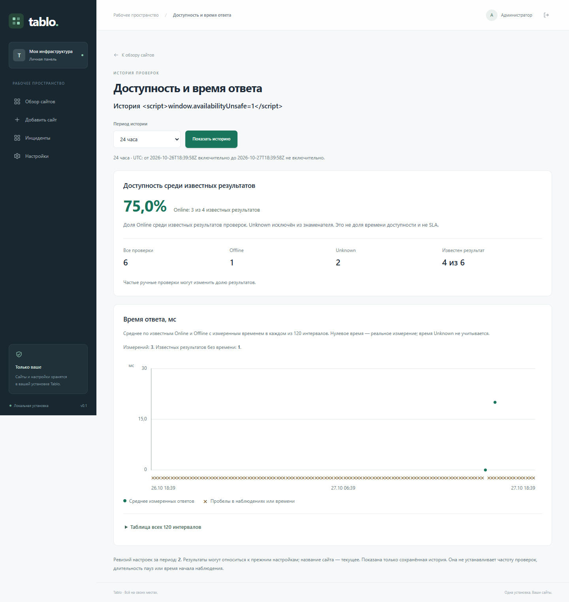
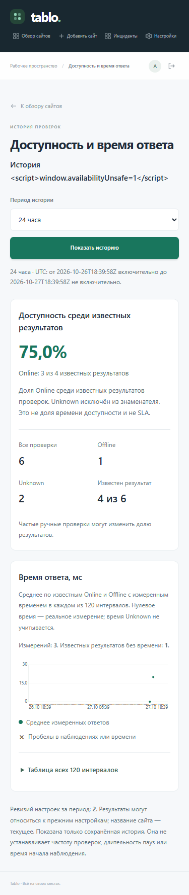

# Availability among retained checks

The private **История проверок** action in either dashboard view opens
`/sites/{id}/history`. The page has a normal GET period selector, a server-rendered
SVG chart and an accessible interval table. It works without JavaScript or an
external chart service. Reading it performs no site/GitHub checks and does not
prune or rewrite history. Ordinary Web authentication, initialization and security
headers still apply; a successful deliberate page visit counts as human activity
for the administrator's idle timeout.

## What the percentage means

Only accepted, currently retained history rows for the selected site and period
participate. Every row is counted once, including distinct IDs with the same
measurement timestamp:

- `U`: Online observations (`online = 1`).
- `O`: Offline observations (`online = 0`).
- `X`: Unknown observations (`online IS NULL`).
- `M = U + O + X`: all retained observations in the window.
- `N = U + O`: observations with a known health result.

With at least two known observations, **availability among checks** is
`100 * U / N`. Unknown results stay visible in the counts and are excluded from
the denominator. The page also shows how many retained results are known (`N`
out of `M`); this is not coverage of expected checks.

An empty history and a history containing only Unknown are distinct no-percentage
states. One known result is insufficient for a percentage, even if other Unknown
rows exist. Real timing measurements can still be displayed. Exact `0%` or `100%`
requires at least two known observations and a unanimous result. Mixed results
near those endpoints use `<0,1%` or `>99,9%` instead of rounding to certainty.
For example, Online + Offline + Unknown gives two known results out of three
retained observations and `50,0%` availability among the known results.

This is a sample-based metric, not elapsed-time uptime, an SLA or a downtime
duration. Frequent manual checks affect the sample ratio. Retained history cannot
establish expected sampling coverage, missed checks, past interval changes or
historical pause durations.

## Period and retention

One captured UTC time `T`, at whole-second precision, defines a rolling window:

| Selection | Duration | One of 120 intervals |
| --- | ---: | ---: |
| 24 hours (default) | 86,400 seconds | 12 minutes |
| 7 days | 604,800 seconds | 84 minutes |
| 30 days | 2,592,000 seconds | 6 hours |

The exact endpoints are shown in UTC. The window is half-open: `[T - duration, T)`.
The start is included, the end and future observations are excluded. These are
fixed elapsed seconds, not local calendar days or daylight-saving boundaries.

Only rows that still exist are included. Retention can leave fewer observations
than the selected period suggests. The oldest retained row is not the monitoring
start, and an empty interval does not prove downtime. Deleting a site removes its
history through the existing foreign key; the page then returns 404.

Pausing a site keeps its earlier observations. The current pause is shown
separately and does not remove earlier rows or create retrospective pause
intervals. Results across retained configuration revisions remain included; their
revision count is shown. The displayed site name and pause state are current
metadata, not reconstructed historical settings.

## Response time and gaps

The chart uses 120 independent, equally sized UTC intervals. Each marker is the
mean of known Online/Offline observations with a non-null response time in that
interval. The table shows the participating count and the measured minimum and
maximum. An Offline HTTP response can have a real measured time; `0` milliseconds
is a real rounded measurement and remains distinct from an absent measurement.
Unknown results do not participate in timing statistics, even if a time value is
present. Their count remains explicit.

Empty intervals, Unknown results and known results without timing are represented
by gap information in text and shape. A partially observed interval can therefore
have both a real mean and a gap marker. No data path joins markers, carries a
previous value forward or interpolates through missing observations. Means are
plotted at interval midpoints, not presented as individual measurement timestamps.
The chart and table label the units in milliseconds and the time zone as UTC.

## Bounded read

The repository selects current ID/name/enabled/revision metadata and only these
history fields: `id`, `config_revision`, `checked_at`, `online`,
`response_time_ms`. It does not project credentials, raw errors, external response
bodies, URLs, repository names or version payloads.

One ordered history SELECT reads at most 12,001 rows. Up to 12,000 rows are
admitted completely. The extra row is an overflow probe: overflow returns no
sample prefix, percentage, summary, plot or interval table. The normal page
explains the limit and keeps the period selector usable. Select a shorter period;
if even 24 hours overflows, analytics remain explicitly unavailable.

All summary and chart calculations consume that one statement's retained result.
There is no durable snapshot across requests. The current site metadata is read
separately, so no atomic current-name/history snapshot is promised. No schema
migration, background rollup, extra database, new bearer API or chart dependency
is introduced.

## Screenshots

These screenshots use an isolated synthetic fixture, with no real repositories,
tokens or installed-site data. The literal HTML-looking site name demonstrates
escaping; it is displayed as text and does not execute.

## Verification

`composer verify` includes deterministic period/metric/bucket/projection tests and
real isolated HTTP cases. They cover Unknown, current pause, multiple revisions,
equal timestamps, half-open boundaries, real zero versus null, insufficient data,
privacy, authority and complete overflow refusal. The exact ordinary test
inventory and the existing selected-engine history case are registered in the
strict CI manifests; existing native identities and resource limits are retained.

The owned browser fixture exercises both dashboard links, all three periods,
keyboard/table semantics, a 375-pixel viewport and operation without JavaScript.
Its synthetic records and runtime are separate from an installed instance.
